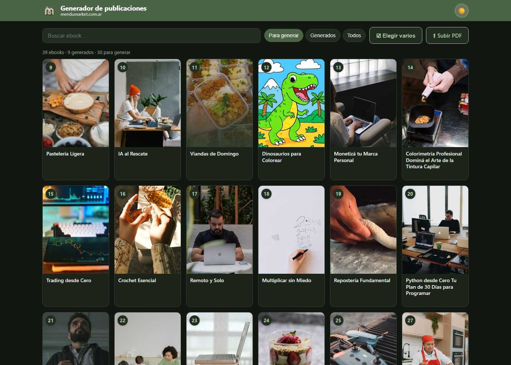
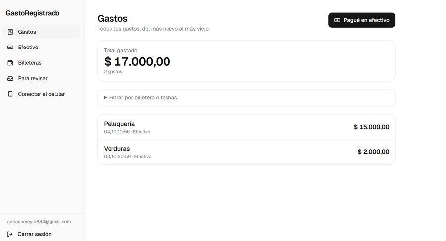
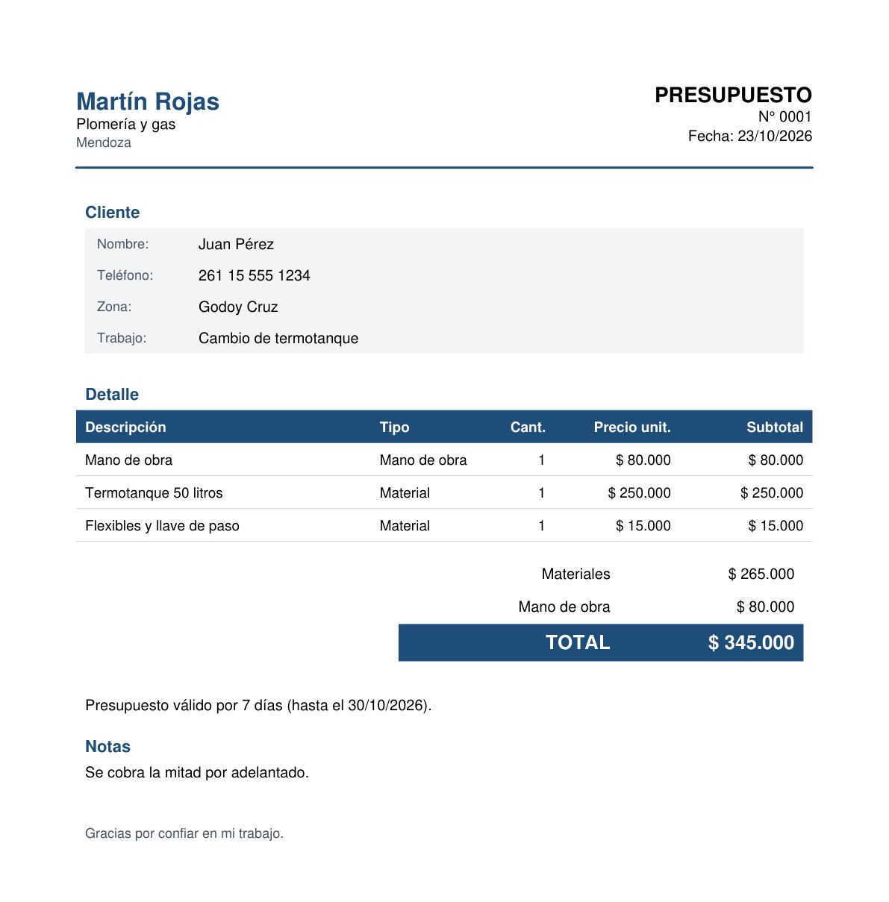
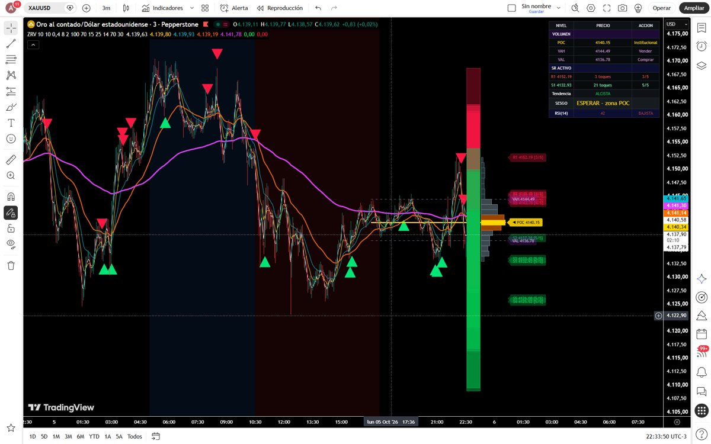

# Adrián Pereyra

Web software developer | Python + AI | E-commerce and custom platforms | Digital and content marketing

I build **websites and tools with Python and artificial intelligence**, from the idea to a site running online. I also create and manage **digital and content marketing**: Facebook and Instagram pages, images, copy and videos for advertising.

Mendoza, Argentina

---

## Featured projects

### MenduEbook: AI ebooks ready to sell

[](https://mendumarket.com.ar)

**A platform that uses AI to create a complete PDF ebook and its sales page, ready to sell.** The customer enters a topic and within minutes receives the designed book (guide, recipe book or coloring book), the sales landing page and instructions to publish it. It takes payments through Mercado Pago, has an admin panel, translates into other languages and runs on its own server. It has already generated more than 60 books.

**Python · Flask · Claude API · OpenAI API · SQLite · Mercado Pago · Google login · Ubuntu server**

[Visit the site](https://mendumarket.com.ar) · [Screenshots, examples and code](https://github.com/adrian884hub/mendu-market-portfolio)

### Mendu Market: online store built from scratch

[](https://mendumarket.com)

**An online store with more than 5,800 products from wholesalers, kept up to date automatically, with Mercado Pago payments and a back office to run the business.** Customers search with instant suggestions, add to the cart and pay without creating an account. The owner passes each order to the wholesaler with one click, and the tracking number reaches the customer by email on its own. Mobile-first, with dark mode.

**Python · Flask · Tailwind CSS · SQLite · Mercado Pago · Wholesaler REST API · Ubuntu server · Nginx**

[Visit the store](https://mendumarket.com) · [Screenshots and details](https://github.com/adrian884hub/mendumarket-tienda-portfolio)

---

## Other projects

### Social post generator: from a book to posts and videos
[](https://github.com/adrian884hub/mendumarket-generador-publicaciones)

An in-house tool for MenduEbook that turns a PDF book into posts ready for social media in a few minutes: feed and story images, vertical videos for Reels and TikTok with an Argentine-accent voice-over and music, and the copy for each network.

**Python · Flask · OpenAI (text and images) · Pillow · FFmpeg** · [Examples and videos](https://github.com/adrian884hub/mendumarket-generador-publicaciones)

### GastoRegistrado: automatic expense log


A web app that automatically records purchases and payments from every digital wallet by reading the phone's notifications, and shows them in a single list with date, amount, merchant and wallet. It installs on the phone as an app.

**Next.js · TypeScript · Supabase (PostgreSQL) · Tailwind CSS · Vitest · Vercel** · *Private code (it handles personal data). A real excerpt: the part that reads the amount from any notification.*

```ts
// "$ 1.000", "$400", "$ 300,00", "US$ 20", "U$S 20"
const IMPORTE = /(US\$|U\$S|USD|\$)\s?(\d{1,3}(?:\.\d{3})+(?:,\d{1,2})?|\d+(?:[.,]\d{1,2})?)/i;

export type TipoLectura =
  | "gasto"        // money going out to another person or merchant
  | "propia"       // transfer between my own wallets: not an expense
  | "entrada"      // money coming in
  | "dudosa"       // has an amount but direction is unclear
  | "sin_importe"; // promotions and notices: ignored
```

### Mendu bot: 24/7 WhatsApp assistant for my stores

Answers customers of my online store and of MenduEbook on WhatsApp, day and night. It replies from real FAQs taken from both websites and doesn't make things up. When someone needs a person (a complaint, a quote, a job offer), the AI collects their name and reason and I get a Telegram alert with a one-tap link to reply. It uses the official WhatsApp Cloud API and runs on my own server with HTTPS.

**Try it:** [message the bot on WhatsApp](https://wa.me/5492612344712)

**Python · Flask · Claude API (tool use) · WhatsApp Cloud API · Telegram Bot API · SQLite · Ubuntu server** · *Private code. A real excerpt: the tool the AI uses to hand a conversation over to me.*

```python
HERRAMIENTAS = [
    {
        "name": "avisar_a_adrian",
        "description": ("Le avisa a Adrián para que responda él. Usala si no sabés la respuesta, si hay una "
                        "queja o un problema con una compra, si piden presupuesto, si alguien quiere una "
                        "página, un bot o marketing, si es un reclutador, o si piden hablar con una persona."),
        "input_schema": {
            "type": "object",
            "properties": {
                "motivo": {"type": "string", "description": "Resumen corto de lo que necesita"},
                "area": {"type": "string", "enum": AREAS,
                         "description": "mendumarket = tienda, menduebook = ebooks, "
                                        "servicios = páginas, bots, marketing o trabajo, otro = lo demás"},
                "nombre": {"type": "string", "description": "Nombre de la persona, si lo dijo"},
            },
            "required": ["motivo", "area"],
        },
    },
]
```

### Booking assistant for barbershops on WhatsApp

A WhatsApp assistant for barbershops and hair salons. It answers prices and opening hours, books, checks and cancels appointments on its own, and alerts the owner on Telegram when a customer asks for a person. The program, not the AI, calculates the free time slots, so it never offers a time that is already taken. Every incoming message is checked against Meta's signature. It runs on my server with a demo business, ready for its first salon.

A real test conversation (in Spanish):

> **Customer:** quiero un turno para corte el sábado a las 11, soy adrian
>
> **Assistant:** ¡Listo, Adrian! Tu turno quedó reservado para el sábado 17/10 a las 11:00 para Corte de pelo, con un precio de $8.000. Te esperamos en Calle Ejemplo 123, Maipú. Si llegás más de 15 minutos tarde, el turno puede perderse.
>
> **Customer:** cancelar mi turno
>
> **Assistant:** Tenés un turno para el sábado 17/10 a las 11:00 (Corte de pelo). ¿Confirmás que querés cancelarlo?
>
> **Customer:** si
>
> **Assistant:** Listo, Adrian, cancelé tu turno del sábado 17/10 a las 11:00. Si querés, después podemos buscarte otro horario.

**Python · Flask · Claude API (tool use) · WhatsApp Cloud API · Telegram Bot API · SQLite · Ubuntu server** · *Private code.*

### Voice quotes: dictate a quote, send it as a PDF


For tradespeople (plumbers, electricians, gas fitters, painters). They dictate the job on their phone in everyday Argentine Spanish, the AI transcribes it and turns it into a quote with materials, labor and total, they review it and send it as a PDF over WhatsApp. It never invents prices: anything that wasn't said is left blank and highlighted. It also lists the quotes sent more than 2 days ago with no answer, with a button to follow up. Above: a sample PDF made by the app (example data).

**Python · Flask · Claude API (structured outputs) · OpenAI speech-to-text · ReportLab · SQLite** · *Private code. A real excerpt: the rules that teach the AI how Argentines say amounts, and forbid made-up prices.*

```python
INSTRUCCIONES = """...
REGLA MÁS IMPORTANTE: NUNCA inventes ni estimes precios.
- Si un ítem no tiene un precio dicho explícitamente, poné precio_unitario en null y agregá a "faltantes" \
algo como "Precio de: <descripción>".
- Nunca uses precios "de mercado", promedios ni suposiciones. Solo lo que se dijo.

Montos en lenguaje argentino:
- "80 lucas" = 80000 | "una luca" = 1000 | "5 lucas" = 5000
- "250 mil" = 250000 | "80 mil pesos" = 80000
- "un palo" = 1000000 | "palo y medio" = 1500000 | "dos palos" = 2000000
- "un palo doscientos" = 1200000 | "ciento veinte mil" = 120000
..."""
```

### Restaurante Los Olivos: website for a restaurant
[](https://adrian884hub.github.io/restaurante-los-olivos/)

Sample site for a restaurant in Mendoza: photo carousel, tabbed menu, reservations sent through WhatsApp and mobile-first design. Includes test cases and bug reports (QA).

**HTML · CSS · JavaScript** · [View the page](https://adrian884hub.github.io/restaurante-los-olivos/) · [Code](https://github.com/adrian884hub/restaurante-los-olivos)

### 30 Keto Recipes: ebook sales landing page
[](https://adrian884hub.github.io/recetas-keto/)

Sales page for a recipe ebook, designed to turn visits into purchases.

**HTML · CSS · JavaScript** · [View the page](https://adrian884hub.github.io/recetas-keto/) · [Code](https://github.com/adrian884hub/recetas-keto)

### Mendu Market help center
[](https://adrian884hub.github.io/faq-mendumarket./)

Frequently asked questions about payments, shipping and returns for the Mendu Market online store, with WhatsApp contact.

**HTML · CSS · JavaScript** · [View the page](https://adrian884hub.github.io/faq-mendumarket./) · [Code](https://github.com/adrian884hub/faq-mendumarket.)

### TradingView indicators


Two technical analysis indicators in Pine Script: automatic support and resistance detection with scoring, volume profile, buy and sell signals by confluence, automatic Stop Loss and Take Profit, and a price heat map.

**Pine Script v5** · [Bounce Zones + Volume](https://github.com/adrian884hub/indicador-zonas-rebote-volumen) · [SR Confluence + Heat Map](https://github.com/adrian884hub/indicadores-tradingview-1-)

### Game Booster: PC cleaner and optimizer


Desktop program that prepares the PC for gaming: cleans temporary files, closes background processes and frees memory with a single button.

**Python · Tkinter · PyInstaller** · [Code](https://github.com/adrian884hub/game-booster)

---

## What I do

- Websites and sales pages
- Platforms with online payments (Mercado Pago)
- Python tools and automation
- Artificial intelligence integrations (Claude, OpenAI)
- WhatsApp assistants with AI (official WhatsApp Cloud API)
- Digital and content marketing for social media
- TradingView indicators (Pine Script)

## Contact

**Available for projects and work.** Get in touch and let's talk.

- Email: [adrianpereyra884@gmail.com](mailto:adrianpereyra884@gmail.com)
- WhatsApp: [+54 261 637-3263](https://wa.me/542616373263)
