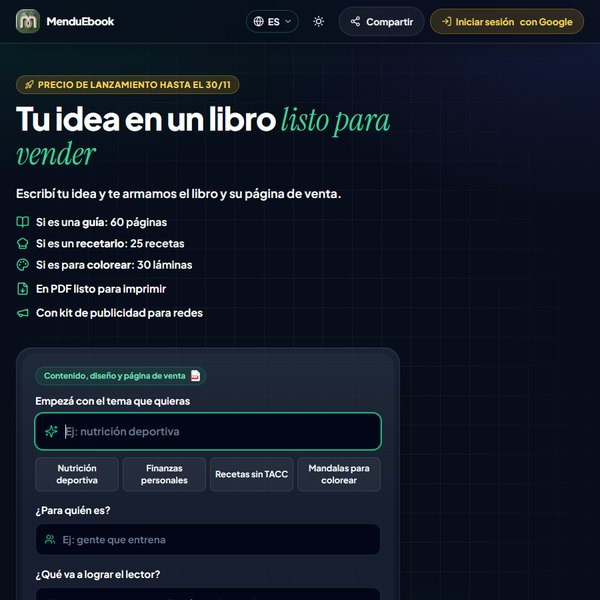
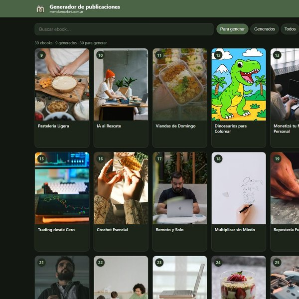
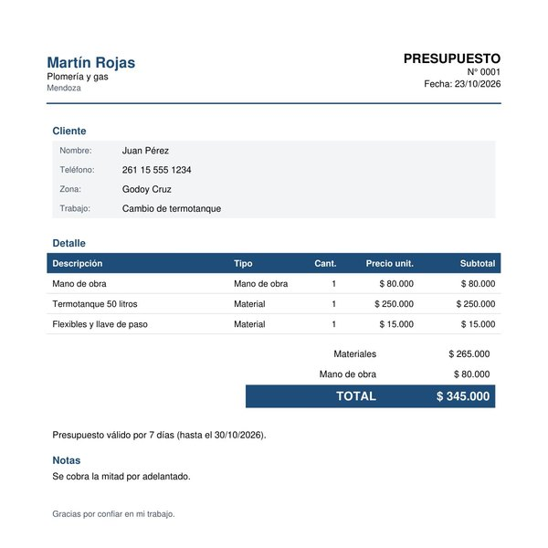
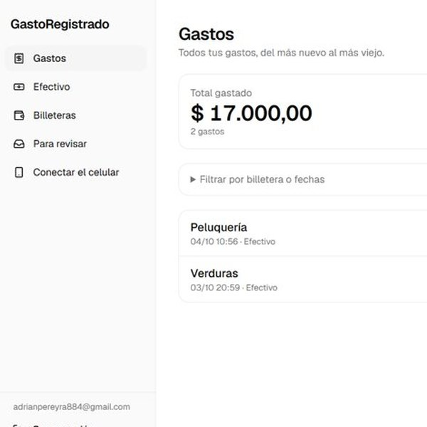
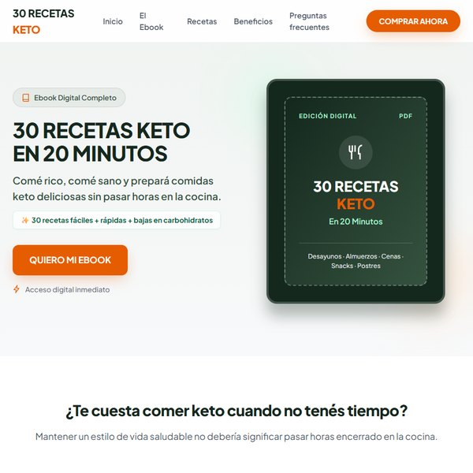
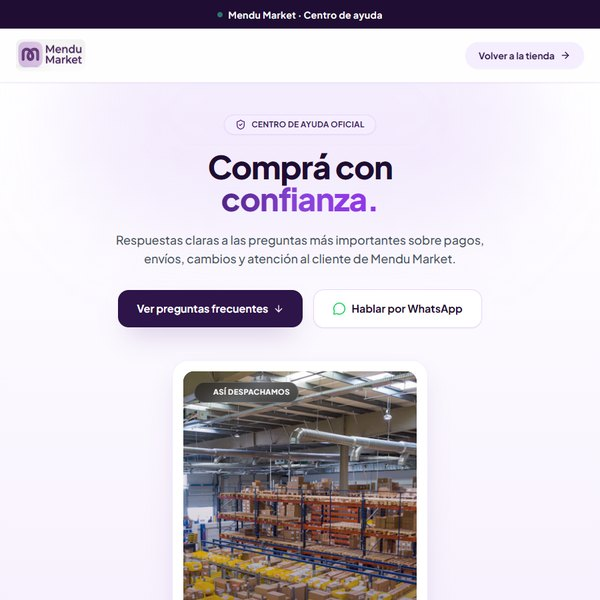
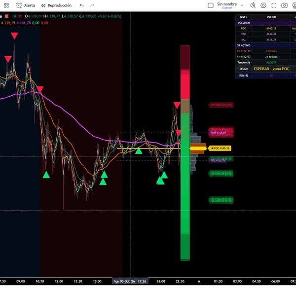

# Adrián Pereyra

**Desarrollador web en Mendoza.** Hago páginas, tiendas online, bots de WhatsApp y herramientas con inteligencia artificial, desde la idea hasta la página andando. También armo el marketing para redes: imágenes, textos y videos.

> **In English:** Web developer in Mendoza, Argentina. I build websites, online stores, WhatsApp bots and AI-powered tools with Python, from the idea to a site running online. Open to projects and remote work.

Python · Flask · Claude · OpenAI · Next.js · Mercado Pago · WhatsApp Cloud API · HTML · CSS · JavaScript

## Proyectos

Tocá la foto para ver el proyecto, o **Ver más** para saber qué hace.

<table>
<tr>
<td align="center" valign="top" width="25%">

 <b>MenduEbook</b>
 Libros con IA, listos para vender

Ver más

El cliente escribe un tema y en minutos recibe el libro en PDF (guía, recetario o para colorear), la página de venta y cómo publicarlo. Cobra con Mercado Pago y ya generó más de 60 libros.

<b>Hecho con:</b> Python · Flask · Claude · OpenAI · Mercado Pago

<a href="https://mendumarket.com.ar">Ver la página</a> · <a href="https://github.com/adrian884hub/mendu-market-portfolio">Capturas y ejemplos</a>

</td>
<td align="center" valign="top" width="25%">

 <b>Mendu Market</b>
 Tienda online hecha desde cero

Ver más

Más de 5.000 productos de mayoristas que se actualizan solos, pago con Mercado Pago y un panel para manejar los pedidos. El número de seguimiento le llega solo al cliente por mail.

<b>Hecho con:</b> Python · Flask · Tailwind CSS · Mercado Pago

<a href="https://mendumarket.com">Ver la tienda</a> · <a href="https://github.com/adrian884hub/mendumarket-tienda-portfolio">Capturas y detalles</a>

</td>
<td align="center" valign="top" width="25%">

 <b>Generador de posteos</b>
 De un libro a posteos y videos

Ver más

Convierte un libro en PDF en publicaciones para redes en pocos minutos: imágenes para el feed y las historias, videos verticales para Reels y TikTok con voz con acento argentino y música, y el texto de cada red.

<b>Hecho con:</b> Python · Flask · OpenAI · FFmpeg

<a href="https://github.com/adrian884hub/mendumarket-generador-publicaciones">Ejemplos y videos</a>

</td>
<td align="center" valign="top" width="25%">

 <b>Bot de Mendu</b>
 Responde WhatsApp día y noche

Ver más

Atiende a los clientes de la tienda y de MenduEbook de día y de noche, con las preguntas frecuentes reales y sin inventar. Si alguien necesita una persona, me avisa por Telegram con un link para responderle.

<b>Hecho con:</b> Python · Flask · Claude · WhatsApp Cloud API · Telegram

<a href="https://wa.me/5492612344712">Probalo en WhatsApp</a> · Charla real: <a href="imagenes/bot-charla-1.jpg">1</a> · <a href="imagenes/bot-charla-2.jpg">2</a> · <a href="imagenes/bot-charla-3.jpg">3</a>

</td>
</tr>
<tr>
<td align="center" valign="top" width="25%">

 <b>Turnos para peluquerías</b>
 Reservas por WhatsApp, solas

Ver más

Responde precios y horarios, da, consulta y cancela turnos, y le avisa al dueño por Telegram cuando un cliente pide hablar con una persona. Los horarios libres los calcula el programa, así nunca ofrece uno ocupado.

<b>Hecho con:</b> Python · Flask · Claude · WhatsApp Cloud API · Telegram

<a href="https://wa.me/542616373263?text=Hola%20Adri%C3%A1n%2C%20quiero%20probar%20el%20bot%20de%20turnos">Pedí una prueba</a> · Charla real: <a href="imagenes/peluqueria-charla-1.jpg">1</a> · <a href="imagenes/peluqueria-charla-2.jpg">2</a> · <a href="imagenes/peluqueria-charla-3.jpg">3</a>

</td>
<td align="center" valign="top" width="25%">

 <b>Presupuestos por voz</b>
 Dictás el trabajo, sale el PDF

Ver más

Para plomeros, electricistas, gasistas y pintores. Dictan el trabajo en el celular, como hablan, y la IA arma el presupuesto con materiales, mano de obra y total, listo para mandar por WhatsApp. Nunca inventa precios: lo que no se dijo queda marcado.

<b>Hecho con:</b> Python · Flask · Claude · OpenAI (voz a texto) · ReportLab

<a href="imagenes/presupuestos-voz.jpg">Ver un presupuesto de ejemplo</a>

</td>
<td align="center" valign="top" width="25%">

 <b>GastoRegistrado</b>
 Tus gastos, anotados solos

Ver más

Lee las notificaciones del celular y anota solas las compras y los pagos de todas las billeteras virtuales, en una sola lista con fecha, monto, comercio y billetera. Se instala en el celular como una app.

<b>Hecho con:</b> Next.js · TypeScript · Supabase · Vercel

<a href="imagenes/gastoregistrado.jpg">Ver captura</a>

</td>
<td align="center" valign="top" width="25%">

 <b>Restaurante Los Olivos</b>
 Página para un restaurante

Ver más

Página de muestra para un restaurante de Mendoza: fotos que pasan solas, menú por pestañas, reservas por WhatsApp y pensada para el celular. Incluye pruebas y reportes de errores.

<b>Hecho con:</b> HTML · CSS · JavaScript

<a href="https://adrian884hub.github.io/restaurante-los-olivos/">Ver la página</a> · <a href="https://github.com/adrian884hub/restaurante-los-olivos">Código</a>

</td>
</tr>
<tr>
<td align="center" valign="top" width="25%">

 <b>30 Recetas Keto</b>
 Página de venta de un ebook

Ver más

Página para vender un libro de recetas, pensada para que la visita termine en una compra.

<b>Hecho con:</b> HTML · CSS · JavaScript

<a href="https://adrian884hub.github.io/recetas-keto/">Ver la página</a> · <a href="https://github.com/adrian884hub/recetas-keto">Código</a>

</td>
<td align="center" valign="top" width="25%">

 <b>Centro de ayuda</b>
 Preguntas frecuentes de la tienda

Ver más

Respuestas sobre pagos, envíos, cambios y devoluciones de Mendu Market, con contacto por WhatsApp.

<b>Hecho con:</b> HTML · CSS · JavaScript

<a href="https://adrian884hub.github.io/faq-mendumarket./">Ver la página</a> · <a href="https://github.com/adrian884hub/faq-mendumarket.">Código</a>

</td>
<td align="center" valign="top" width="25%">

 <b>Indicadores de trading</b>
 Señales de compra y venta

Ver más

Dos indicadores para TradingView: encuentran solos los soportes y las resistencias, muestran el volumen por precio, dan señales de compra y venta, y marcan dónde poner el Stop Loss y el Take Profit.

<b>Hecho con:</b> Pine Script

<a href="https://github.com/adrian884hub/indicador-zonas-rebote-volumen">Zonas de rebote + volumen</a> · <a href="https://github.com/adrian884hub/indicadores-tradingview-1-">Confluencia + mapa de calor</a>

</td>
<td align="center" valign="top" width="25%">

 <b>Game Booster</b>
 La PC lista para jugar

Ver más

Programa para la PC que borra archivos temporales, cierra lo que corre por detrás y libera memoria con un solo botón.

<b>Hecho con:</b> Python · Tkinter

<a href="https://github.com/adrian884hub/game-booster">Código</a>

</td>
</tr>
</table>

## ¿Querés algo así para tu negocio?

Una página, una tienda, un bot de WhatsApp o el marketing de tus redes. **Escribime por [WhatsApp](https://wa.me/542616373263) o a [adrianpereyra884@gmail.com](mailto:adrianpereyra884@gmail.com)** y lo charlamos.
